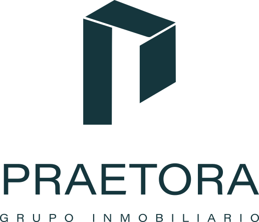

# PRAETORA — Identidad de marca

Guía de la marca que usa el sitio, al 19 de octubre de 2026: logotipos, color, letra, ritmo, fotografía y tono. Sirve para todo lo que se haga con la marca PRAETORA, como el sitio, la landing de Praetora Studio o cualquier pieza.

Lo que todavía no está decidido viene marcado como **pendiente**: no se inventa, se le pregunta a YOPE (Luis).

> **Para un asistente (Claude u otro):** este archivo es la fuente de verdad de la marca. Para ponerlo al día en una bóveda o en notas: copia las tablas como están, conserva los valores exactos (colores en hex, tamaños en px, nombres de archivo) y respeta la sección «Pendientes». Los logotipos están en `assets/marca/`.

---

## 1. Logotipo

Símbolo de la «P» en volumen + **PRAETORA** + **GRUPO INMOBILIARIO**. Los diseñó YOPE (Luis); el original es un `.ai` con 8 mesas de trabajo, que tiene Luis y no está en el repo.

Todas las versiones van en **`assets/marca/`** en SVG, con el texto convertido a curvas: no necesitan la letra instalada. Vienen sin fondo y recortadas al dibujo.

| Versión | Verde (sobre fondo claro) | Blanco (sobre fondo oscuro o foto) |
|---|---|---|
| **Nombre solo:** PRAETORA, sin símbolo ni descriptor | `praetora-nombre.svg` | `praetora-nombre-blanco.svg` |
| **Vertical:** símbolo arriba, nombre y descriptor abajo | `praetora-vertical.svg` | `praetora-vertical-blanco.svg` |
| **Horizontal:** el símbolo hace de P de PRAETORA, con descriptor | `praetora-horizontal.svg` | `praetora-horizontal-blanco.svg` |
| **Horizontal corto:** sin GRUPO INMOBILIARIO | `praetora-horizontal-corto.svg` | `praetora-horizontal-corto-blanco.svg` |
| **Símbolo solo** (isotipo) | `praetora-simbolo.svg` | `praetora-simbolo-blanco.svg` |

<p>
  
  &nbsp;&nbsp;
  
  &nbsp;&nbsp;
  
</p>
<p>
  
  &nbsp;&nbsp;
  
</p>

**Reglas**
- **Color del logotipo:** verde petróleo **`#15363D`** (RGB 21 · 54 · 61), o **blanco** `#FFFFFF` sobre fondo oscuro o foto.
- **Todo el logotipo va en un solo color.** En el `.ai`, GRUPO INMOBILIARIO del vertical sale en negro por un descuido; en los SVG ya va en verde.
- **Letra del logotipo:** Acumin (Variable Concept), la misma familia que el sitio. Ya va en curvas, así que no hay que instalarla.
- **En el sitio va el nombre solo** (decisión de YOPE del 14-oct):
  - en la portada, en blanco sobre la foto;
  - en el encabezado del catálogo, en verde;
  - en el encabezado de Invertir, en blanco;
  - en la barra de la ficha, en verde.

  Ese cambio ya está hecho en la copia de Luis, pero todavía no está en GitHub: hoy el sitio en GitHub muestra el nombre en texto.
- El nombre y «Praetora Studio» llevan `translate="no"` en el HTML: el sitio lo traduce el navegador y la marca no se traduce.

---

## 2. Color

**El sitio es acromático, sin color de acento.** Cuatro grises y blanco: esa ausencia es el sistema.

| Rol | Token en `styles.css` | Valor |
|---|---|---|
| Fondo | `--bg-primary` | `#FFFFFF` |
| Tinta principal (texto, botones) | `--ink` · `--text-main` | `#111111` |
| Tinta secundaria | `--text-muted` | `#222222` |
| Apagado (valores de ficha, pies, navegación inactiva, pie de página) | `--text-light` | `#AAAAAA` |
| Línea | `--border-subtle` | `#E6E6E6` |
| Relleno de espera (foto que no carga) | `--gold-subtle` | `#F2F2F2` |

**Colores fuera del sistema, cada uno en un solo lugar:**

| Color | Valor | Dónde |
|---|---|---|
| Verde petróleo | `#15363D` | Sólo el logotipo |
| Vino | `#3E101A` | Texto de Casa Julieta en la portada (`--julieta-tinta`) |
| Azul cielo | `#0859A9` | Fondo de la página Invertir, el azul de lo alto de su foto |

**Eliminados, no se usan:** el oro cepillado `#B8934A`, el travertino `#F8F6F1` y el carbón espresso `#201D19`. Los tokens `--gold-*` siguen en `styles.css` por compatibilidad, pero ya valen negro y grises.

---

## 3. Letra

**Una sola familia: Acumin Pro**, por Adobe Fonts (Creative Cloud de YOPE, proyecto web `eyy5hrp`).

```html
<link rel="stylesheet" href="https://use.typekit.net/eyy5hrp.css">
```

```css
font-family: "acumin-pro", -apple-system, 'Segoe UI', Helvetica, Arial, sans-serif;
```

- **El archivo `.otf` nunca se sube a un repo ni a un sitio.** La licencia de escritorio no cubre la web y el archivo quedaría expuesto. En la web, la letra entra sólo por el `<link>` de arriba.
- **Para diseñar en la compu** (Photoshop, Illustrator, Figma), Acumin Pro se activa con una cuenta de Creative Cloud en fonts.adobe.com.
- **En el texto se usan dos pesos: 400 y 500.** La jerarquía la dan el tamaño y el color, nunca el peso.
- **Excepciones por diseño de YOPE:** la navegación del hero va en peso 300, y el texto de Casa Julieta en la portada lleva tamaños propios de su composición.
- Acumin es más angosta que Inter: en párrafos, de 45 a 50 caracteres por renglón.

### Sistema tipográfico

Regla de YOPE: *«No podemos manejar diferentes tamaños de letras y diferentes fonts.»* Cada texto nuevo toma una función de esta tabla; no hay tamaños sueltos.

| Función | px | Peso | Interlineado | Dónde |
|---|---|---|---|---|
| Título | 32 | 500 | 1.2 | Títulos de sección, nombre de la casa |
| Título secundario / dato | 24 | 500 | 1.2 | Subtítulos, cifras (m², recámaras) |
| Subtítulo / nombre | 20 | 500 | 1.3 | Nombre en tarjetas, precio |
| Texto destacado | 18 | 400 | 1.6 | Párrafos de presentación |
| Texto | 16 | 400 | 1.5 | Listas, datos de ficha |
| Pie | 14 | 400 | 1.6 | Pie de página, notas |
| Etiqueta / menú | 12 | 500 | 1.5 | MAYÚSCULAS con +0.12 em. Las mayúsculas sólo se usan a 12 px |

**El tracking (separación de letras) sólo va en las etiquetas en mayúsculas y en el logotipo.** Los párrafos van sin tracking.

### Dos estilos de acción, y sólo dos

| Tipo | Cuándo | Estilo |
|---|---|---|
| **Enlace de navegación** | Lleva a otra página: Catálogo completo · Ver ficha · Volver al catálogo | 18 px · 400 · tipo oración · flecha larga → (← para volver) · subrayado de 1 px |
| **Botón de acción** | Hace algo: Consultar esta casa · Continuar · Solicitar información | 12 px · 500 · MAYÚSCULAS · fondo negro y letra blanca (invertido sobre fondo oscuro) · sin flecha · esquinas rectas |

---

## 4. Ritmo y espaciado

| Uso | Valor | Token |
|---|---|---|
| Margen lateral | 24 px en todos los anchos | `--gutter` |
| Grupo cercano | 12 px | `--space-close` |
| Bloque interno | 64 px | `--space-block` |
| Entre secciones | 128 px | `--space-section` |
| Antes del pie | 192 px | `--space-footer` |

---

## 5. Fotografía

- **Casi a sangre:** la foto ocupa todo el ancho menos los 24 px de margen.
- **Esquinas rectas (radio 0), sin sombra.** Rectángulo duro sobre blanco.
- **Proporciones:**
  - 16:9 para exteriores, fachadas y contexto;
  - 3:4 en pares, para interiores y detalle;
  - 3:2 para miniaturas.
- Las fotos son las de las casas reales, en `assets/propiedades/<casa>/fotos`. No van fotos de stock.

---

## 6. Tono

- **Trato de usted** en todo el sitio.
- **Palabras que no:**
  - «gratuito», porque el servicio no lo es;
  - garantías como «blindaje» o «verificado 100 %»;
  - la IA presentada como «asesor»: no sustituye asesoría legal, financiera ni de valuación;
  - escasez falsa, como «últimas unidades» cuando no es verdad.
- **Datos:** sólo los verificados. Lo que el anuncio no publica no se rellena, ni con cero ni con un valor inventado.
- Las tres casas del Club de Golf se entregan **sin muebles y con cocina equipada**. Ningún texto sugiere mobiliario incluido.

---

## 7. Estructura de la marca

- **Nombre completo:** PRAETORA Grupo Inmobiliario. **Dominio:** `praetora.mx`.
- **El menú tiene tres puertas:**
  - **Propiedades:** comprar y vender;
  - **Invertir:** oportunidades que PRAETORA busca, analiza y filtra;
  - **Praetora Studio:** servicios para desarrolladores e inmobiliarias, y búsqueda de capital para proyectos. Es la landing de Mau. Adentro se presenta como «Servicios para desarrolladores e inmobiliarias».
- **Mercado:** por ahora sólo San Miguel de Allende.

---

## 8. Pendientes de marca (no inventar)

- Si el verde `#15363D` entra como color de marca más allá del logotipo.
- Dónde va el símbolo solo en el sitio. Por eso todavía no hay favicon.
- El claim o tagline.
- El origen y el significado del nombre.
- Las palabras que sí son de PRAETORA.

---

## Dónde vive en el código

- **Tokens:** `:root` al principio de `styles.css`.
- **Sistema tipográfico:** bloque «SISTEMA TIPOGRÁFICO» al final de `styles.css`. Va al final a propósito, para mandar sobre las reglas viejas.
- **Logotipos:** `assets/marca/`.
